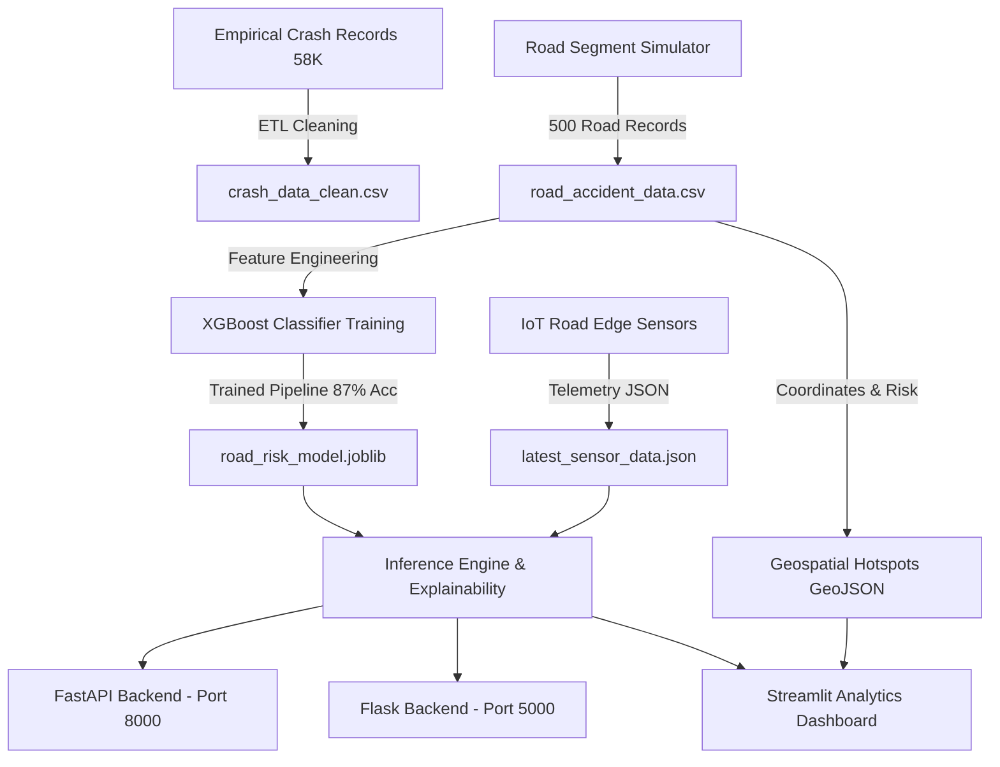

# 🚦 AI-Powered Road Accident Risk & IoT Telemetry System

An end-to-end intelligent road safety platform combining **high-frequency IoT sensor telemetry**, **XGBoost machine learning (87.0% accuracy)**, **geospatial accident hotspot mapping**, dual **FastAPI & Flask REST APIs**, and an interactive **Streamlit analytics dashboard**.

---

## 📌 Project Overview

This project provides real-time accident risk evaluation for smart highway management. By synthesizing dynamic road metrics (vehicle velocity, traffic density, atmospheric visibility, surface traction, weather conditions, and accident history), our XGBoost classifier predicts accident likelihood into three calibrated tiers:
- **🟢 Low Risk:** Optimal flow, high visibility, dry asphalt.
- **🟠 Medium Risk:** Emerging bottlenecks, wet surface, moderate visibility constraints.
- **🔴 High Risk:** Severe congestion, adverse weather (fog/rain), impaired visibility, damaged road surface, or known accident black-spots.

The system incorporates both empirical historical crash records (**58,963 ground-truth incidents**) and real-time streaming IoT telemetry across **500 road segments** in Delhi-NCR.

---

## 🏗️ System Architecture



---

## 🛠️ Technology Stack

| Layer | Technologies |
|---|---|
| **Machine Learning** | XGBoost 3.x, Scikit-learn, Joblib, NumPy, Pandas |
| **Edge & IoT Simulation**| Python telemetry generators, JSON data store |
| **APIs & Backends** | FastAPI, Uvicorn, Flask, Pydantic |
| **Geospatial & Mapping** | GeoJSON, Plotly Express Mapbox/Carto, GeoPandas |
| **Frontend Dashboard** | Streamlit 1.x, Plotly Graph Objects, Custom CSS |
| **Verification & Testing**| Automated unit verification test suite (`test_model.py`) |

---

## 📁 Repository Structure

```
Road_Accident_Project/
├── Data/
│   ├── CrashDataReport.csv           # Raw historical Arizona crash dataset (59K rows, 23MB)
│   ├── crash_data_clean.csv          # Cleaned & risk-mapped empirical crash database
│   ├── road_accident_data.csv        # 500 road segments with traffic & risk features
│   ├── road_accident_locations.geojson # Geospatial point features for map visualization
│   └── latest_sensor_data.json       # Live telemetry broadcast from IoT sensor node
├── api.py                            # Production FastAPI REST service with Swagger UI
├── app.py                            # Production Flask REST API
├── dashboard.py                      # Multi-tab Streamlit monitoring & analytics dashboard
├── geospatial_analysis.py            # Point conversion & GeoJSON export pipeline
├── iot_predictor.py                  # Standalone CLI IoT telemetry risk evaluator
├── iot_sensor_simulator.py           # Real-time IoT road sensor simulator
├── prepare_crash_data.py             # Data cleaning pipeline for empirical crash dataset
├── requirements.txt                  # Python dependencies
├── road_data_simulator.py            # Synthetic Delhi-NCR 500-segment dataset generator
├── road_risk_model.joblib            # Trained XGBoost model package & metadata
├── test_model.py                     # 11-step automated verification test suite
└── utils.py                          # Reusable model loading, prediction & explanation utils
```

---

## 🚀 Quickstart & How to Run

### 1. Install Dependencies
```bash
cd Road_Accident_Project
pip install -r requirements.txt
```

### 2. Verify System Health (Automated Test Suite)
Run all 11 automated verification tests (model accuracy, scenario predictions, probability calibration, data loading, GeoJSON validity):
```bash
python test_model.py
```
*Expected Output:* `Test Results: 11/11 Passed (100.0%) - ALL TESTS PASSED SUCCESSFULLY!`

---

### 3. Launch the Interactive Dashboard
Launch the multi-tab Streamlit dashboard:
```bash
streamlit run dashboard.py
```
The dashboard features:
- **🛰️ Tab 1: Real-Time IoT Monitor:** Live risk alert banner, probability distribution bar chart, telemetry metric cards, GPS location mini-map, and an interactive **"What-If" Scenario Simulator**.
- **🗺️ Tab 2: Geospatial Hotspots:** Interactive map of all 500 road segments colored by risk level with hover tooltips and black-spot filters.
- **📊 Tab 3: Sensor Analytics:** Speed vs Traffic volume correlation, risk distributions, weather and road surface impact.
- **📁 Tab 4: Historical Crash Database:** Exploration of 58,963 ground-truth crash records (injuries, fatalities, collision types).
- **🧠 Tab 5: Model Diagnostics:** XGBoost feature importance rankings, hyperparameters, and test evaluation metrics.

---

### 4. Run the REST APIs

#### Option A: FastAPI (Recommended, with Swagger Docs)
```bash
uvicorn api:app --reload --port 8000
```
- Interactive Swagger UI: [http://localhost:8000/docs](http://localhost:8000/docs)
- Interactive ReDoc: [http://localhost:8000/redoc](http://localhost:8000/redoc)

#### Option B: Flask API
```bash
python app.py
```
- Base URL: [http://localhost:5000/](http://localhost:5000/)

---

### 5. Run IoT Sensor Simulation
Simulate continuous edge telemetry (updates every 5 seconds):
```bash
python iot_sensor_simulator.py
```
Or generate a single reading:
```bash
python iot_sensor_simulator.py --once
```

### 6. Run Instant CLI Predictor
Evaluate current risk from terminal:
```bash
python iot_predictor.py
```

### 7. Re-train the Machine Learning Model
```bash
python train_ml_model.py
```

---

## 📡 REST API Reference

| Method | Endpoint | Description |
|---|---|---|
| `GET` | `/` | API status, model details, and route directory |
| `GET` | `/health` | System health check and model loading verification |
| `POST` | `/predict` | Predict risk level, confidence probabilities, and explanation |
| `GET` | `/sensor/latest` | Retrieve current IoT road node telemetry reading |
| `POST` | `/sensor/simulate` | Generate and store fresh randomized sensor telemetry |
| `GET` | `/model/info` | XGBoost accuracy, features, and importance weights |
| `GET` | `/stats` | Summary statistics of the road network dataset |
| `GET` | `/geojson` | GeoJSON FeatureCollection of hotspots (optional `?risk=High`) |

### Sample Prediction Payload (`POST /predict`)
```json
{
  "latitude": 28.6139,
  "longitude": 77.2090,
  "traffic_volume": 950,
  "average_speed": 30.0,
  "weather_condition": "Rain",
  "visibility": 2.5,
  "road_condition": "Wet",
  "historical_accidents": 15
}
```

### Sample Prediction Response
```json
{
  "risk": "High",
  "probabilities": {
    "Low": 0.0001,
    "Medium": 0.0027,
    "High": 0.9972
  },
  "explanation": "Key risk drivers: heavy traffic congestion (950 vehicles/hr); atmospheric precipitation reducing tire traction (Rain); wet road surface with reduced braking grip; historically hazardous black-spot zone (15 past crashes recorded).\nRecommended interventions: reroute non-essential traffic or enable congestion alerts; broadcast wet asphalt caution to motorists; advise increased following distance; increase automated traffic monitoring & patrol frequency."
}
```

---

## 🎯 Model Features & Importance Ranking

| Feature | Predictive Weight | Description |
|---|---|---|
| `historical_accidents` | **22.88%** | Past crashes recorded on this road segment |
| `traffic_volume` | **17.21%** | Vehicle density per hour |
| `weather_condition` | **16.98%** | Atmospheric condition (Clear, Rain, Fog) |
| `visibility` | **13.64%** | Line-of-sight distance (km) |
| `average_speed` | **10.10%** | Average vehicle velocity (km/h) |
| `road_condition` | **8.17%** | Asphalt surface state (Dry, Wet, Damaged) |
| `latitude` | **5.59%** | Coordinate north |
| `longitude` | **5.44%** | Coordinate east |

---

## 👥 Contributors & Academic Reference
Project developed for HCL Final Project / Road Safety IoT & Applied Machine Learning Initiative.
